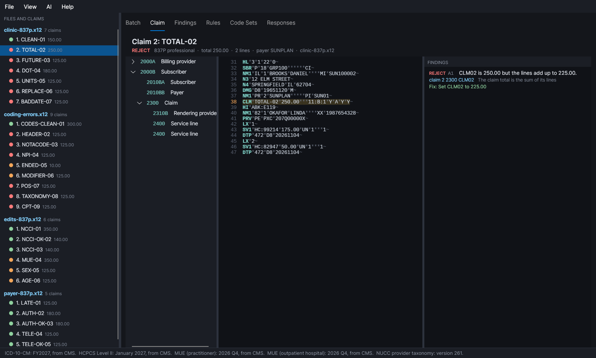
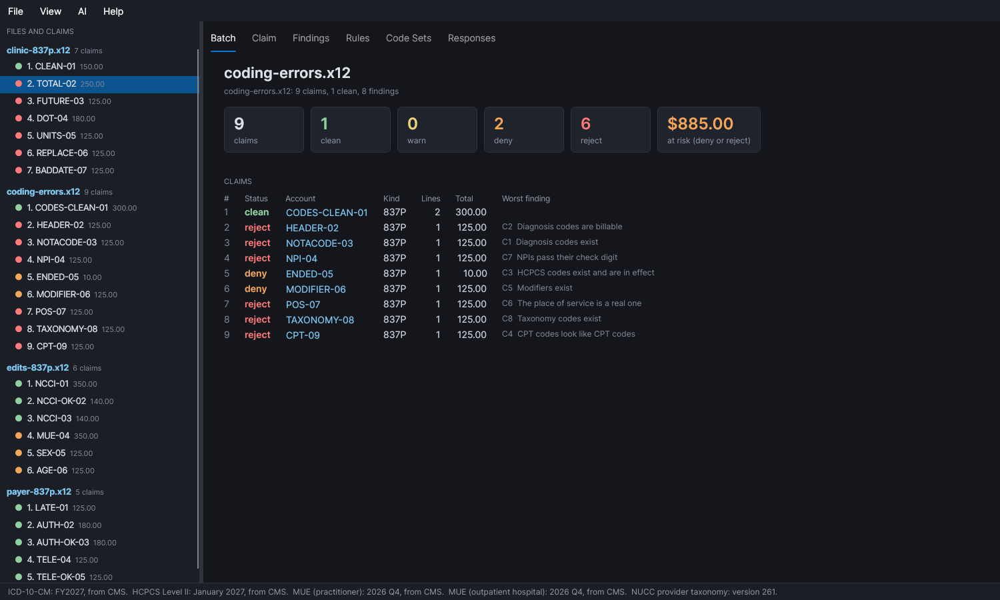
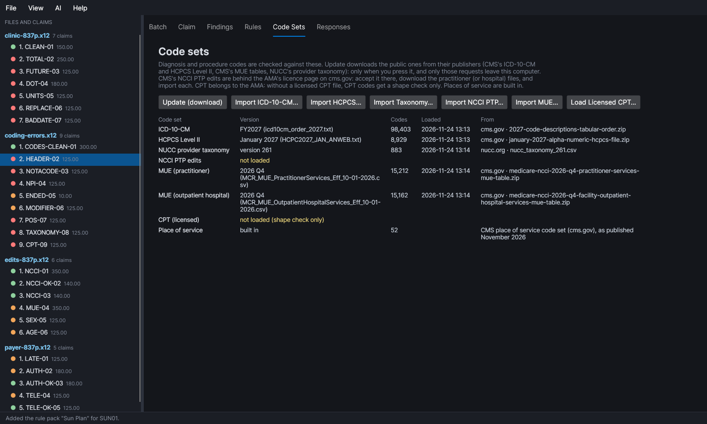
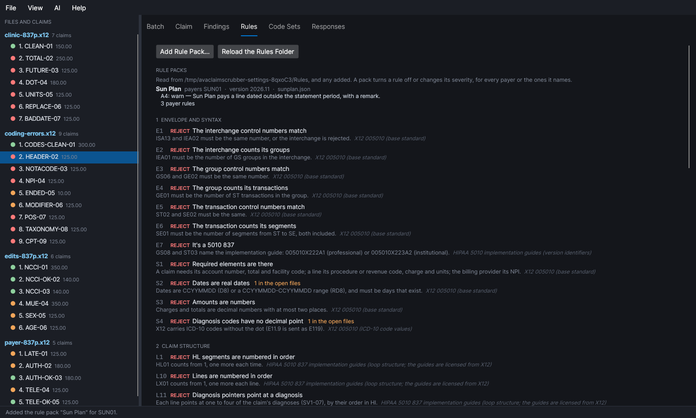
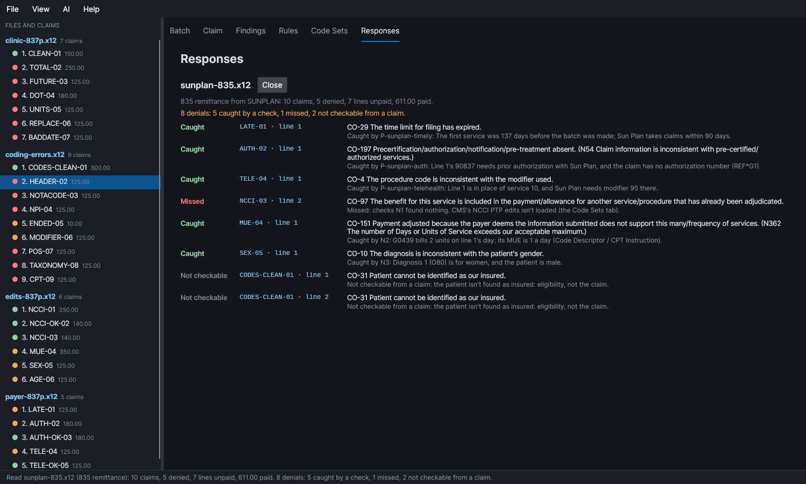
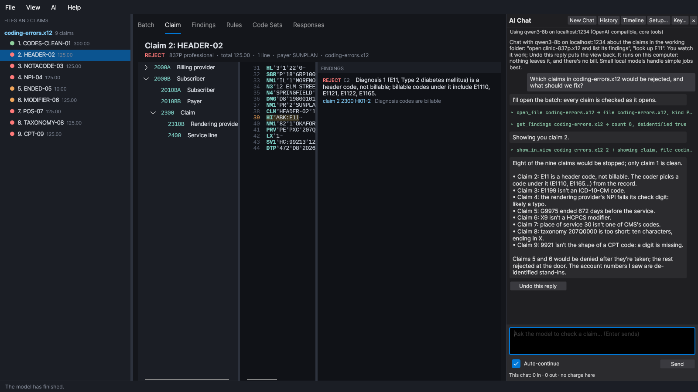

# AVA Claim Scrubber

Catch a claim's problems before the payer does. AVA Claim Scrubber checks HIPAA **837P** (professional) and **837I**
(institutional) 5010 claims the way a clearinghouse and a payer would, before they're sent: the envelope's counts and
control numbers, the loop structure, the arithmetic and dates, every code against the real code sets (ICD-10-CM, HCPCS,
CPT's shape, modifiers, places of service, NPIs, taxonomies), Medicare's NCCI and MUE edits, and the payer's own rules.
Each finding says what's wrong, where (the claim, line, loop and element, such as `2400 SV1-04`), why (the rule and
its source) and, when the fix is clear, the fix, which it can make for you in a corrected copy.

Then it closes the loop: open the payer's **999**, **277CA** or **835** beside the claims and it **replays every denial**
against the findings: which a check caught, which it missed, and which no check could catch (eligibility, medical
necessity). Missed denials a payer rule would have caught become a **drafted rule pack** for you to check and add.

It has an **AI Chat** (F12) and an **MCP server**, so Claude or a model on your own computer can explain a batch's
problems, look up a code or a denial, or draft payer rules. **Agents see de-identified claims** unless you say
otherwise. See [AI: the chat and agents](#ai-the-chat-and-agents).



## Download

Builds for Windows, macOS and Linux (Intel/AMD and ARM) are on the
[releases page](https://github.com/Harlock123/AVAClaimScrubber/releases). Unzip or untar and run `AVAClaimScrubber`
(`AVAClaimScrubber.exe` on Windows); nothing else needs installing.

## What it checks

Six layers, each rule with an id, a reason and a source. Severities say what would happen to the claim: **reject** (a
clearinghouse or payer won't take it), **deny** (it'll be taken and not paid), **warn** and **info**. A claim's status is
its worst finding.

| Layer | Rules | What |
|---|---|---|
| 1 Envelope and syntax | E1–E7, S1–S4 | ISA/IEA, GS/GE and ST/SE control numbers and counts; the 5010 version; required elements; real dates (D8, RD8); amounts; ICD codes sent without the decimal point |
| 2 Structure | L1–L12 | The HL hierarchy (numbering, parents, levels); the billing provider, subscriber and payer loops; a diagnosis on every claim; lines numbered in order; diagnosis pointers that point at a diagnosis |
| 3 Arithmetic and dates | A1–A6 | The claim total is the sum of its lines; units; no service after the batch was made; lines inside an institutional claim's statement period; a replacement or void (frequency 7 or 8) carries the original's claim number |
| 4 Code sets | C1–C9 | ICD-10-CM codes exist and are billable (a header such as E11 names billable codes under it); HCPCS codes were in effect on the service date; CPT codes have CPT's shape; modifiers exist; places of service are CMS's; every NPI passes its check digit; taxonomies are NUCC's |
| 5 Medicare's edits | N1–N4 | NCCI procedure-to-procedure pairs (with the modifiers that let a pair through); medically unlikely edits, per line or per day; diagnoses that don't fit the patient's sex or age, by ICD-10-CM chapter |
| 6 Payer rules | from rule packs | Filing limits, prior authorization, a modifier a place of service needs (telehealth 95), unit limits, procedures a payer doesn't cover |

Dates are checked as of the batch's creation (BHT04), so a file checks the same whenever it's opened.




## Code sets

Codes are checked against the publishers' own files, never bundled with the program. **Update** on the Code Sets tab
downloads them, and those requests are the only thing that leaves your computer:

| Set | From | Notes |
|---|---|---|
| ICD-10-CM | CMS, the fiscal year's order file | Billable flags and titles; a new year starts each October 1 |
| HCPCS Level II and its modifiers | CMS, the newest quarterly alpha-numeric file | Added and terminated dates, so a code is checked against the service date |
| MUE tables | CMS, practitioner and outpatient hospital | Units per line or per day |
| Provider taxonomy | NUCC, the newest CSV | |
| NCCI PTP edits | CMS, behind the AMA's licence page | Accept the licence on cms.gov, download the files, and **Import NCCI PTP…** |
| CPT | the AMA (licensed) | Without a licensed file, CPT codes get a shape check only; **Load Licensed CPT…** takes yours |
| Places of service | CMS, built in | 52 codes |

Any set can also be imported from a file you have. A set that isn't loaded is said once, as information, and its codes
aren't judged.



## Rule packs

A rule pack is a JSON file of a payer's differences: rules turned off or changed in severity, and payer rules. Packs in
the settings folder's `Rules` folder are read at start; **File › Add Rule Pack…** adds one.

```json
{
  "format": "avaclaimscrubber.rules",
  "name": "Sun Plan",
  "version": "2026.11",
  "payers": ["SUN01"],
  "overrides": { "A4": { "severity": "warn", "why": "Sun Plan pays a line dated outside the statement period, with a remark." } },
  "rules": [
    { "id": "timely", "kind": "timely-filing", "days": 90 },
    { "id": "auth", "kind": "prior-auth", "procedures": ["90837"] },
    { "id": "telehealth", "kind": "require-modifier", "places": ["02", "10"], "modifier": "95" }
  ]
}
```

`payers` are the payer IDs in 2010BB NM109 (none: every payer). Rule kinds: `timely-filing` (days), `prior-auth`
(procedures that need REF\*G1), `require-modifier` (places, modifier), `max-units` (procedure, units), `not-covered`
(procedures). A pack is checked as it's read, and the Rules tab lists every rule with its reason and source.



## Fixes

**File › Save Corrected Copy…** writes a new file with the fixes the findings suggest (counts, control numbers, totals,
line numbers, decimal points in diagnoses) and nothing else: the same separators, line breaks and every other segment.
It opens the copy, checks it, and lists each change (segment, element, was → now, why). The original is never touched.
Fixes that need a person (which code, which date) are left as findings.

## Responses and denial replay

Open a **999**, **277CA** or **835** (File › Open) beside the claims it answers. Each denial or rejection is matched to its
claim (by the account number, CLM01; a 999's errors by the control numbers and the segment's position) and set against
the claim's findings:

- **Caught**: a check flagged it for the payer's reason (CARC 97, bundled, against the NCCI check; a 277CA's "claim is
  out of balance" against the total check).
- **Missed**: a check or a payer rule could have, and didn't. When a code set it needs isn't loaded, it says so.
- **Not checkable**: nothing in a claim shows it (the patient isn't insured, medical necessity, an attachment needed).
- **No claim**: the claim isn't open.

Reason codes are explained in X12's own words (the CARC, RARC and claim status code lists from x12.org). **Draft Rule
Pack…** turns the missed denials a payer rule would catch into a pack: prior authorization from CARC 197, a filing
limit below the shortest gap denied under CARC 29, a modifier from paid and denied lines in the same place of service,
unit limits from the units paid. Each rule's `why` says what it was drafted from. It's saved as a file for you to check
against the payer's policy and add; it's never used by itself.



**File › Export Report…** writes the lot (every file's claims and findings, the rules behind them, and the replays) as an
HTML page or an Excel workbook. Reports list claims by account number: handle them as you handle the claims.

## AI: the chat and agents

**AI › AI Chat** (F12) opens a chat on the right. It works with Claude (an Anthropic API key) or a model on your own
computer or network (Ollama, LM Studio, or any OpenAI-compatible server; or a local server that speaks Anthropic's
Messages API), with every tool, or a core set for small models. Undo this reply puts the view back.



**Agents see de-identified claims.** Names, member and account numbers, payer claim numbers, addresses and dates are
replaced with stand-ins as a file is read (the same stand-in every time in a session, in claims and responses alike, so
a remittance still matches its claims), while the checks run on the real file, and findings never quote a person's
details. Codes, amounts and the structure are kept. **AI › Let AI Agents See Real Values** turns that off; use it only
with a model your organisation may send PHI to. Starting with `--deidentify` keeps it on whatever the setting says.

Outside agents (Claude Code, Claude Desktop, any MCP client) connect in three ways:

```bash
# Attached to the open window (AI › Allow AI Agents must be on): the agent works on the claims open there.
claude mcp add avaclaimscrubber -- /path/to/AVAClaimScrubber --mcp --attach

# Headless, on a folder of X12 files, with the window's rule packs and code sets.
claude mcp add avaclaimscrubber -- /path/to/AVAClaimScrubber --mcp --root /path/to/claims

# Over the network, with a token (AI › Connect an Agent in the window, or headless):
AVAClaimScrubber --mcp --http 8777 --root /path/to/claims [--token TOKEN] [--cert CERT --key KEY]
```

Agents only write new files in the working folder; they never change a rule pack or code set you use.

| Tool | What it does |
|---|---|
| `list_files` | The X12 files in the working folder and what each is (837P, 837I, 999, 277CA, 835) |
| `open_file`, `close_file`, `list_open` | Open an 837 (checking it) or a response; what's open, with the packs and code sets in use |
| `get_batch` | A file's claims: status, charge, lines and findings each, and the envelope's findings |
| `get_claim` | One claim: diagnoses, lines, payer, NPI and its findings with fixes |
| `get_segments` | A claim's raw segments (or the file's), with the ones findings point at marked |
| `get_findings` | Findings across the open files, worst first, by severity, rule, layer or claim |
| `check_text` | Checks an 837 given as text, without saving it |
| `list_rules`, `explain_rule` | The rules by layer; one rule's reason, source, and the denial codes it answers to |
| `list_rule_packs`, `test_rule_pack`, `write_rule_pack` | The packs in use; what a pack would add or take away; save one for you to add |
| `get_code_sets`, `lookup_code`, `search_codes` | What's loaded; any code (ICD, HCPCS, modifier, CPT shape, taxonomy, place of service, NPI, CARC, RARC, 277 status); words in the code sets |
| `get_response`, `replay` | A 999, 277CA or 835 in full; its denials replayed against the findings |
| `draft_rule_pack` | Payer rules drafted from the missed denials, with their evidence |
| `save_corrected_copy` | A corrected copy with the clear fixes (de-identified when agents are) |
| `export_report` | The report, `.html` or `.xlsx` |
| `deidentify_file` | A de-identified copy of any X12 file, always, for sharing a problem claim |
| `get_view`, `show_in_view`, `render_view` | What the window shows; select a claim or tab there; a picture of a claim with its problems marked |
| `batch`, `get_recording`, `save_steps`, `run_steps` | Several calls at once; keep a session's calls and run them again on next month's files |
| `checkpoint`, `diff`, `render_checkpoint`, `restore_checkpoint` | Remember the open files and view, see what changed, go back |

Recipes (MCP prompts): scrub a batch, make the clear fixes, explain a denial code, replay a remittance, draft payer
rules from denials, look up a claim's codes, try a rule pack, and a month-end report.

## Command line

```bash
AVAClaimScrubber [files…] [--real | --deidentify]   # open and check files; what agents see
AVAClaimScrubber --mcp [--attach] [--root FOLDER] [--real | --deidentify] [--http PORT …]
AVAClaimScrubber --deidentify INPUT OUTPUT          # de-identified copies of a file or a folder
```

## Samples

`samples/` has invented claims, made by `make_samples.py`, each clean or with one planted problem named in its account
number (`TOTAL-02`, `HEADER-02`, `NCCI-03`…): `clinic-837p.x12`, `hospital-837i.x12`, `envelope-errors.x12`,
`structure-errors.x12`, `coding-errors.x12`, `edits-837p.x12` and `payer-837p.x12`; `responses/` has two 999s, a 277CA
and an 835 that answer them; `rules/sunplan.json` an invented payer's pack. Every patient, member, provider, NPI and
tax ID is made up.

## What it isn't

It isn't a certified edit engine. The age and sex checks work by ICD-10-CM chapter, as the Medicare Code Editor's
categories do, not from its full tables; NCCI and CPT need files you're licensed for; payer rules are what your packs
say. It doesn't check eligibility or look NPIs up in NPPES. Use it to stop the avoidable rejections and denials, not
as the last word on a claim.

## Building

```bash
dotnet build AVAClaimScrubber.slnx
dotnet test AVAClaimScrubber.slnx
CLAIMS_LIVE_DOWNLOADS=1 dotnet test           # also downloads the real code sets and checks the samples against them
CLAIMS_SHOTS=Screenshots CLAIMS_LIVE_DOWNLOADS=1 dotnet test --filter Screenshots   # these pictures
```

.NET 10 and Avalonia 11.3. `AGENTS.md` has how the code is put together.

## License

MIT
